# JW Studio — Connected Commerce & AI Operations

**Websites, ecommerce, AI customer support, multichannel operations, and marketing automation in one platform.**

JW Studio connects the tools a business needs to present its services, answer customer questions, manage enquiries and orders, and prepare its next marketing campaign.

Built with **Laravel, PHP, and MySQL**, the project combines a visual website workspace with commerce services, AI-assisted support, marketplace workflows, and a dedicated Marketing Studio.

[View the live storefront](https://ecom.jwaistudio.online/) · [Marketing Studio — account required](https://ecom.jwaistudio.online/admin/marketing)

> Project showcase. Integration availability depends on provider credentials, platform approval, and deployment configuration. See the status table for the reviewed scope.

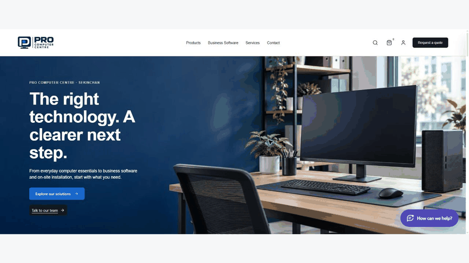

[Watch the MP4](docs/showcase/01-landing-scroll.mp4)

*Live deployment: Pro Computer Centre, an example of the platform applied to a product and service business. The platform is designed for reuse across industries.*

## What the platform brings together

| Area | Capabilities |
| --- | --- |
| **Build an online presence** | Business websites, visual page editing, industry themes, and AI-assisted CMS page generation. |
| **Run commerce and operations** | Ecommerce, enquiries and quotations, marketplace order workflows, payments, and shipping. |
| **Connect customer support** | Website AI chat, a multichannel support inbox, shared AI configuration, and an approval-based FAQ improvement workflow. |
| **Understand and grow the business** | Operational reports, content preparation, and AI post generation with scheduling and publishing controls. |

## Twelve core capabilities

### 1. Business Websites & Visual Website Builder

Build business websites, landing pages, and product or service showcases using reusable sections and industry themes.

- Edit content through a visual canvas, section outline, and inspector.
- Preview desktop, tablet, and mobile layouts.
- Manage page status, homepage selection, navigation, and page history.
- Keep content editing connected to the storefront catalog.

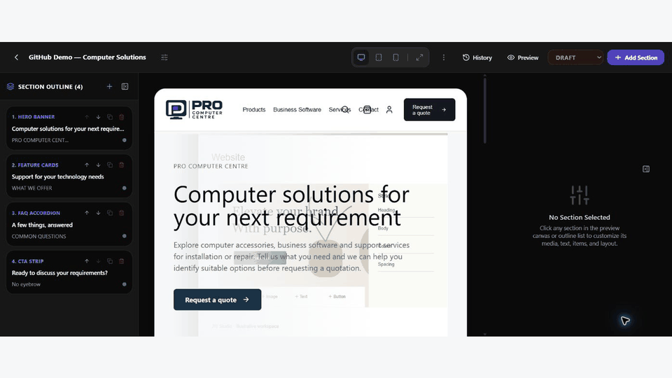

[Watch the MP4](docs/showcase/02-cms-add-section.mp4)

*Local demonstration draft: open the section library and insert an FAQ section. This walkthrough uses captured before, selection, and after states; the existing live homepage is unchanged.*

### 2. Ecommerce & Order Operations

Manage products and their transaction paths from a shared administration workspace.

- Products, SKU variants, pricing, imagery, categories, and collections.
- Direct purchase, enquiry-based purchase, and display-only catalog modes.
- Shopping cart, checkout, promotions, customer accounts, and order tracking.
- Order payment and fulfillment states, with server-side pricing and stock rules.

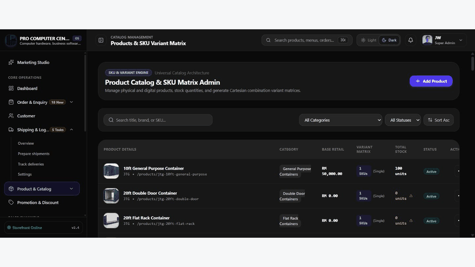

[Watch the MP4](docs/showcase/03-add-product.mp4)

*Local recording: product catalog → Add Product → basic information, pricing, and purchase-mode controls. No product was saved.*

### 3. Website AI Support Chat

Give visitors a conversational entry point for product, service, and business questions.

- Website chat with an accompanying FAQ guide.
- English, Chinese, and Bahasa Melayu language options.
- Configurable business knowledge and response boundaries.
- Human handoff for questions that need staff attention.

### 4. Multichannel Social AI Chat

Bring customer conversations into a shared support workspace, with channel-level AI controls and human takeover.

- Website, Facebook, Instagram, and WhatsApp channel configuration.
- Shared AI personality, knowledge scope, and safety settings.
- Conversation queues and customer context for support staff.
- A TikTok channel surface, subject to platform approval and integration readiness.

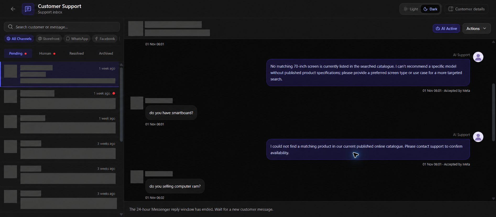

*Live deployment: the actual `/admin/support` inbox, displaying an existing conversation and channel filters. No message was sent during capture. Personal names, account identities, profile images, and conversation-list previews are redacted in this capture. TikTok AI remains subject to approval.*

### 5. Marketplace Order Management System

Connect marketplace operations with product mapping and inventory management.

- Shopee and Lazada integration services and marketplace order workflows.
- Product and SKU mapping between the central catalog and connected stores.
- Shared stock pool and independent stock workflows.
- First-count controls, stock intake, audit adjustments, reservations, and synchronization status.

TikTok Shop is part of the intended marketplace coverage; its operational readiness requires separate verification. This showcase does not claim all three marketplaces are production-connected.

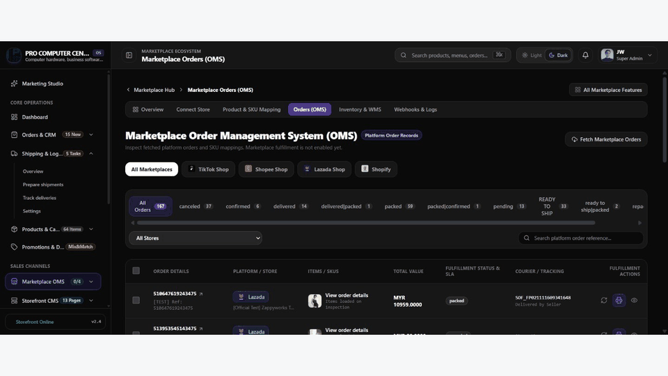

[Watch the MP4](docs/showcase/05-marketplace-oms.mp4)

*Live `/admin/marketplace/oms` recording: multiple fetched Lazada official-test orders. Test labels are retained. The page states that marketplace fulfillment is not enabled; no fetch, refresh, booking, or fulfillment action was executed.*

### 6. Payment Gateway Integration

Connect payment handling to order and quotation workflows.

- Hosted payment integration code for Stripe Checkout, PayPal Orders, and Billplz.
- Bank transfer / DuitNow payment proof and review workflows.
- Payment records, webhook processing, and order-state handling.
- Configurable payment methods and sandbox workflows.

The reviewed live configuration labels Credit Card, PayPal, and Atome as **sandbox / simulated**. It is not evidence of live payment processing for those methods.

### 7. Courier & Shipping Integration

Manage delivery rates, shipment preparation, and delivery follow-up from the administration workspace.

- EasyParcel multi-carrier integration.
- Shipment booking, airway bill, tracking, and reconciliation service paths.
- External courier and in-house delivery workflows.
- Configuration surfaces for J&T, Ninja Van, Pos Laju, Flash Express, and DHL eCommerce.

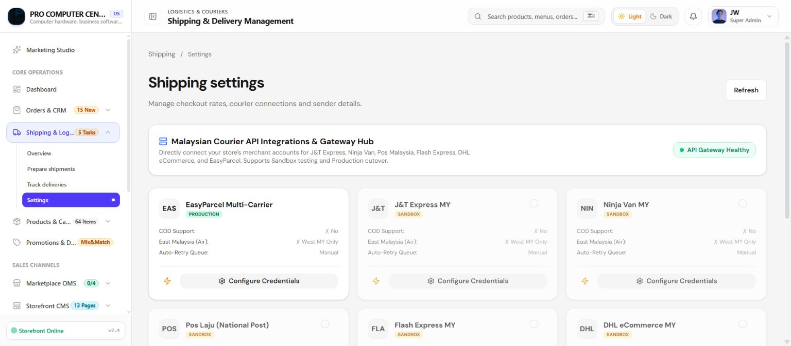

*Live deployment screenshot: EasyParcel is configured as Production and enabled. The other visible carrier integrations are sandbox and disabled; their presence does not establish a working direct carrier connection.*

### 8. AI CMS Page Generator

Use existing business information and catalog context to prepare website content for review.

- Start a new page from a business brief.
- Improve an existing page while retaining its structure.
- Focus changes on an individual section.
- Review generated content in the visual editing workflow before publication.

A dedicated local demonstration generated an outline and English page copy, reused existing images, reviewed the result, and saved editable CMS content as a draft. It did not publish the page or generate new images.

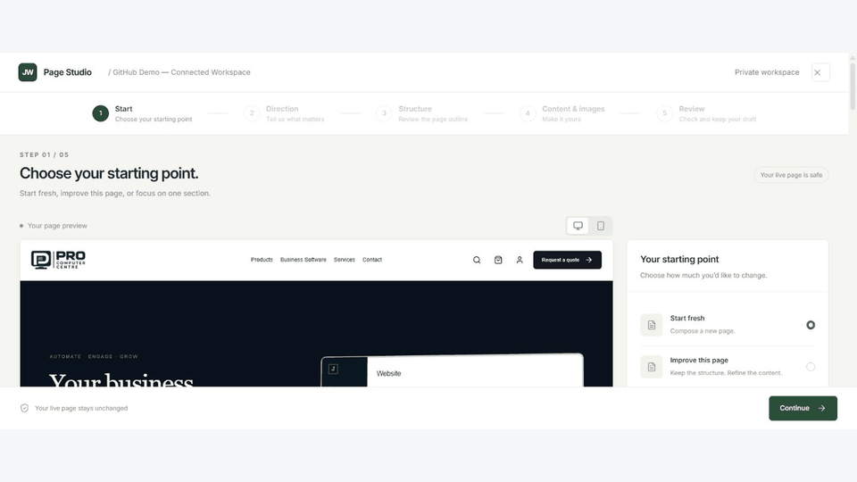

[Watch the MP4](docs/showcase/08-ai-cms-steps.mp4)

View the five steps and the saved draft

**1. Starting point**

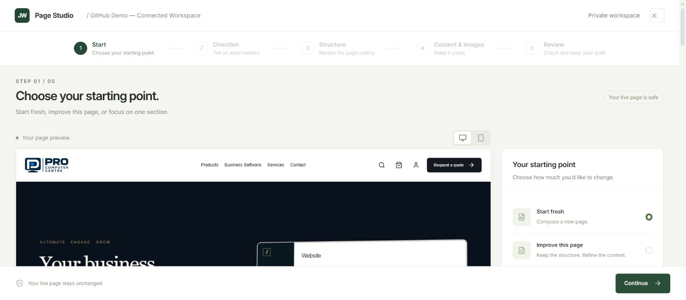

**2. Business brief and direction**

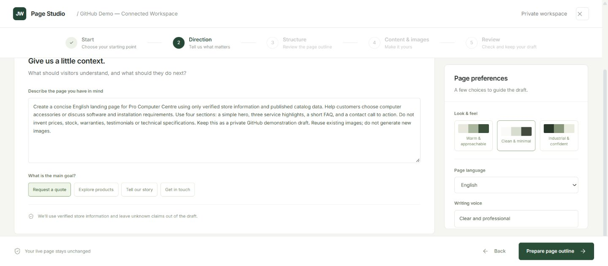

**3. Review the generated outline**

**4. Review generated copy and existing images**

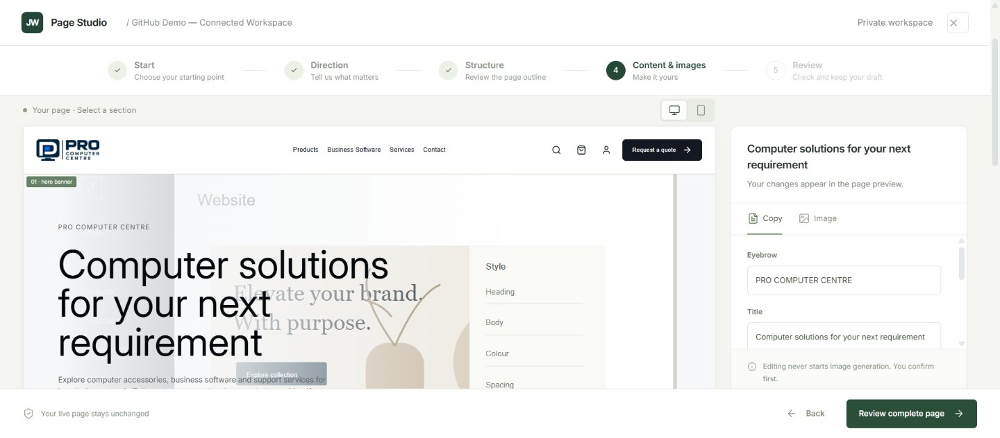

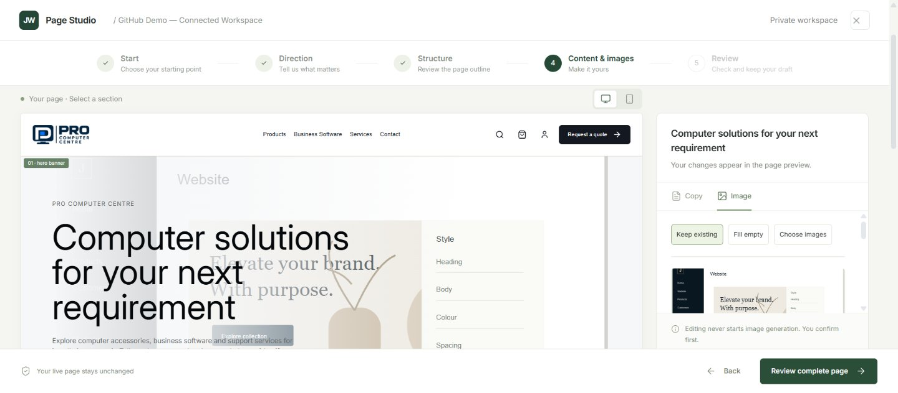

**5. Final review**

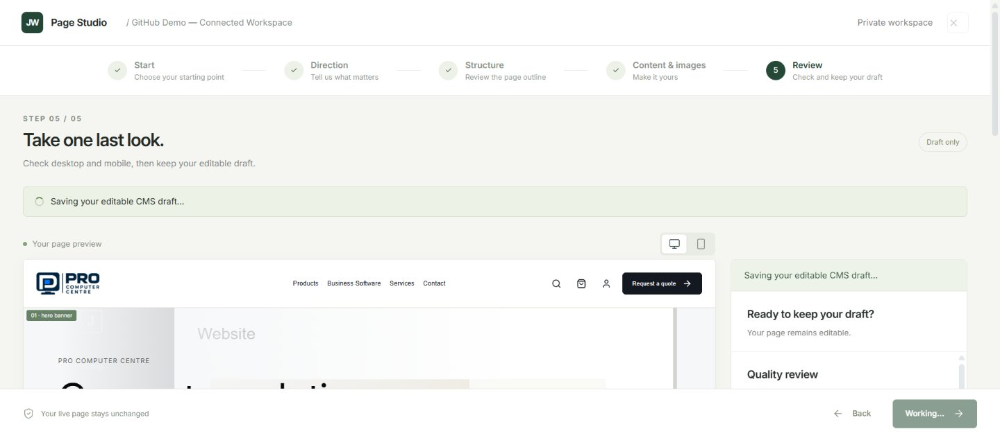

**Saved as an editable draft**

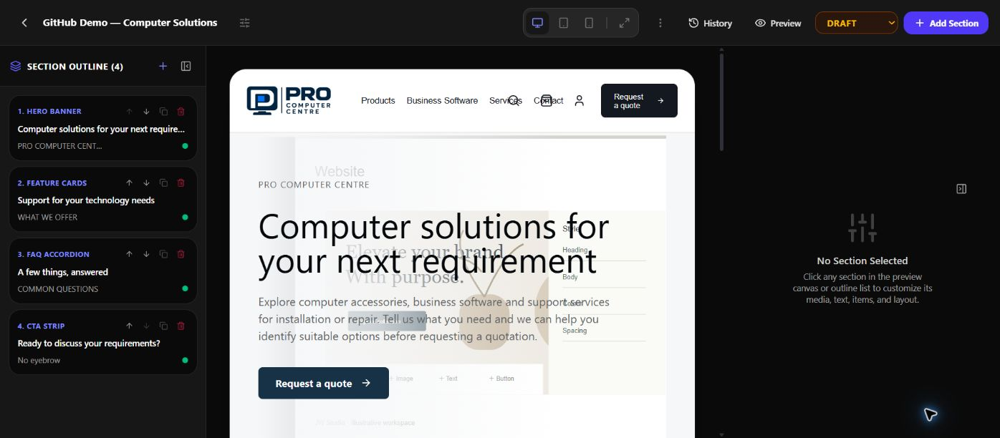

*Step walkthrough assembled from real captures. Reading pauses and generation waits are edited for brevity.*

### 9. Enquiry & Quotation Services

Support businesses where the right next step is a quotation rather than an immediate cart purchase.

- Product and service enquiry intake.
- Staff assignment, follow-up status, and internal notes.
- Quotation drafts and immutable sent versions.
- A dedicated quotation acceptance and checkout path, separate from normal cart checkout.

The local demonstration uses a fictional customer, an `example.test` address, and a clearly labeled DEMO ONLY quotation. It shows the request, merchant review, site publication, and the customer’s quotation document. Customer acceptance, checkout, payment, and fulfillment were not executed.

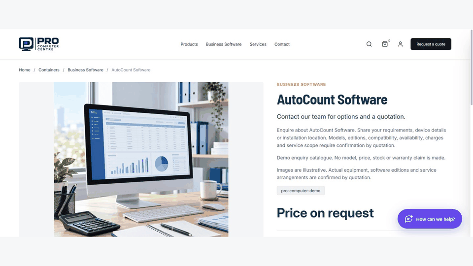

[Watch the customer request MP4](docs/showcase/09-request-quote.mp4)

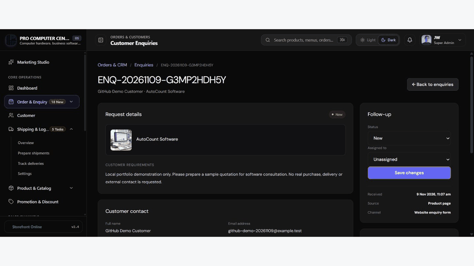

[Watch the merchant review MP4](docs/showcase/10-quotation-admin.mp4)

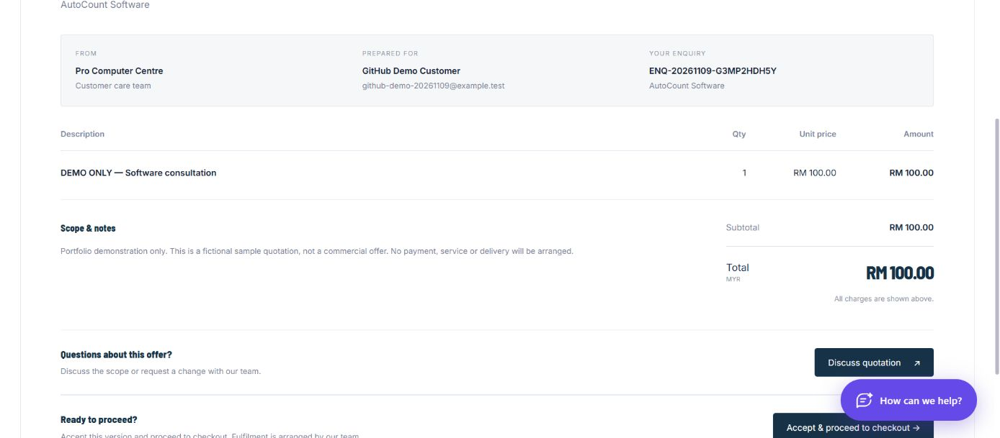

*The merchant action is labeled “Send quotation”: it publishes the approved version to the customer’s private enquiry. The confirmation explicitly states that no email is sent.*

### 10. FAQ & Support Improvement Center

Turn recurring support questions into reviewed business knowledge.

- Identify questions that need better answers.
- Review the original conversation and suggested answer.
- Edit conditions and remove one-off commitments before publishing.
- Add approved answers to the knowledge used by AI support.

**Staff approval controls which suggested answers become available to AI.**

### 11. Reports & Analytics

Review operational data across seven reporting areas:

| Reporting area | Focus |
| --- | --- |
| Sales & revenue | Confirmed payments, completed refunds, and net collections. |
| Orders & enquiries | Order activity and enquiry workflows. |
| Products & inventory | Merchandise and inventory reporting. |
| Customers | Purchasing customer activity and cohorts. |
| Shipping & delivery | Shipment status, costs, and event coverage. |
| Payments & reconciliation | Recorded payment, refund, and tax evidence. |
| Marketing & conversion | Campaign analytics and recorded attribution. |

Reports expose date and currency controls, exports where supported, and data-coverage warnings. Missing historical facts remain unavailable rather than being inferred. Net profit and ROAS are not presented as verified capabilities.

### 12. Marketing Studio — AI Post Automation & Scheduler

Prepare social content using business sources, product information, and brand preferences.

- Generate platform-specific copy and artwork for Facebook, Instagram, and TikTok drafts.
- Manage posts, assets, content types, and schedules.
- Configure generation days, time, timezone, language, and creative direction.
- Control scheduled generation and automatic publishing separately.
- Keep manual generation as a draft-first workflow for review.

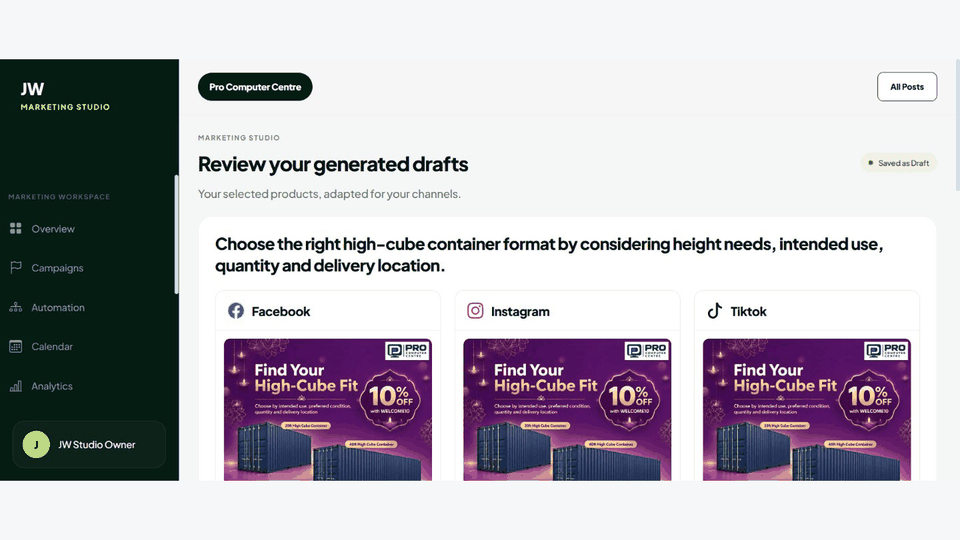

[Watch the MP4](docs/showcase/12-generated-posts.mp4)

*Local capture of the requested existing generation result: channel-specific artwork and copy, saved as drafts. No new marketing generation or social publication was triggered.*

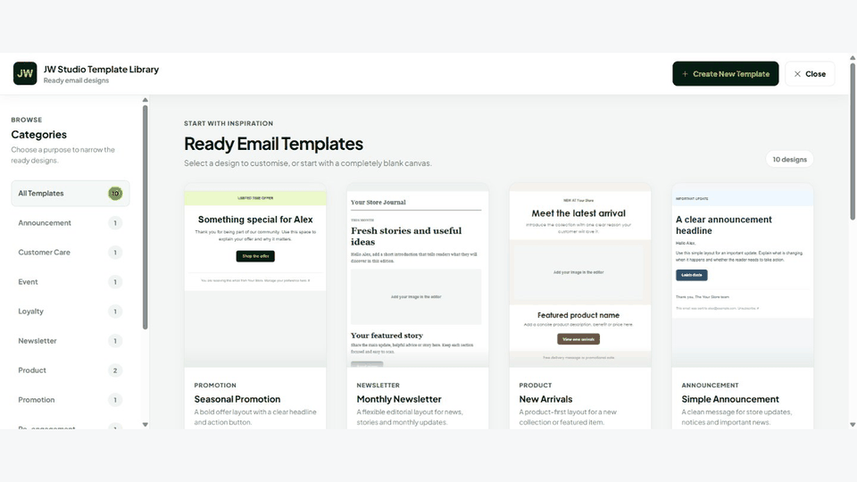

[Watch the template MP4](docs/showcase/13-email-templates.mp4)

*Local Email Templates library and Seasonal Promotion preview. Opening a template does not send a campaign.*

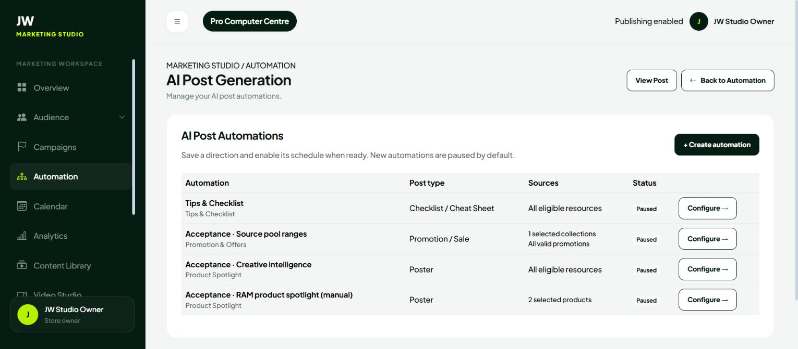

*Local development screenshot: saved automations. The reviewed live Brand Story automation was paused, with automatic publishing off.*

The Marketing Studio overview currently uses **preview / sample data**. Video rendering is unavailable on the reviewed shared-host deployment pending runtime migration and verification. These limits are separate from the post preparation and automation configuration workflows.

## Architecture & Technology

| Layer | Technologies and responsibilities |
| --- | --- |
| Backend | PHP 8.2+, Laravel 12, business services, validation, authorization, and transactional workflows. |
| Operational data | MySQL-backed catalog, customers, orders, inventory, quotations, and module records. |
| Frontend | Blade, Alpine.js, Livewire, React / TypeScript administration interfaces, and Tailwind CSS. |
| Asset pipeline | Vite and separate application / administration build configurations. |
| Background work | Queued jobs, scheduled tasks, webhook handling, and reconciliation workflows. |
| External integrations | AI providers, social platforms, marketplaces, payment providers, and shipping services. |

The implementation connects approved UI layouts to Laravel services and persisted business data. External provider adapters keep provider-specific behavior outside the core business workflows.

## Current Integration & Acceptance Status

Snapshot from the review on **9 November 2026**. A visible configuration screen is evidence of the interface, not a substitute for end-to-end acceptance.

| Area | Current boundary |
| --- | --- |
| Website & CMS | Live storefront reviewed; local AI outline/copy generated and saved as a draft. A new section was inserted only in the demonstration draft. No live page publication. |
| AI support | Four channel AI controls showed enabled; TikTok AI awaited approval. No live messages were sent during review. |
| Marketplace OMS | The specific live `/admin/marketplace/oms` page loaded fetched Lazada official-test orders. Marketplace fulfillment is explicitly disabled. The separate `/admin/marketplace` hub returned HTTP 500 in the earlier review. |
| Quotations | A new local test enquiry and DEMO ONLY quotation were created; the sent customer document was inspected. No customer acceptance or payment. The live `/admin/enquiries` error from the earlier review remains uninvestigated. |
| Payments | The visible live methods were sandbox / simulated. Live merchant processing requires provider-specific acceptance. |
| Shipping | EasyParcel showed enabled Production configuration. Other listed direct carrier configurations were sandbox and disabled. |
| Reports | Seven reporting categories were visible. Sales showed partial-data warnings; historical completeness is limited. |
| Marketing automation | Live schedule and publishing controls were accessible. The reviewed automation was paused with automatic publishing off; automatic execution was not exercised. |

## Development & Documentation

This is an actively developed application, with local acceptance preceding an approved release. Provider credentials, runtime dependencies, and environment configuration are required for the corresponding integrations.

For an isolated development installation, start with the [XAMPP setup guide](docs/xampp-setup.md). Never run installation or seed commands against an existing business database without reviewing their effects.

Useful project references:

- [Commerce acceptance checklist](docs/acceptance/jw-ecommerce-p1-p4-master-checklist.md)
- [Shared stock pool inventory contract](docs/contracts/shared-stock-pool-inventory.md)
- [Source asset register](docs/source-assets.md)

Screenshots are labeled **Live** or **Local development** to distinguish their source. Demonstration products and preview metrics are not customer performance claims. Third-party names identify integration targets; no affiliation or endorsement is implied. Asset redistribution permissions must be reviewed before public release.
